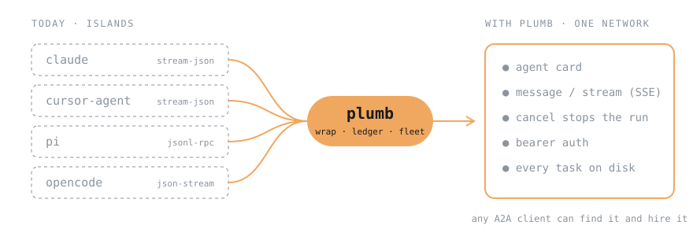

<div align="center">

# plumb

### Your coding agent, on the network.

`plumb wrap claude` and Claude Code becomes an agent that any other agent can find, hire, stream and cancel, over the open [A2A](https://a2a-protocol.org) protocol. Same for Codex, Cursor, Pi, OpenCode, Aider, or any CLI that prints to stdout.

[](https://github.com/kariemSeiam/plumb/actions/workflows/ci.yml) [](https://www.npmjs.com/package/plumb-bridge) [](LICENSE)



</div>

## The problem

The best coding agents live in terminals. Each one speaks its own dialect on stdout:
`stream-json`, JSONL-RPC, plain text. None of them can be called by another agent.
So every multi-agent setup starts the same way: someone writes glue, again.

[MCP](https://modelcontextprotocol.io) gave agents tools. [ACP](https://agentclientprotocol.com) gave editors a way to drive one agent.
**A2A lets agents hire each other.** Plumb is the missing pipe: it puts the CLI agents you already use on that network.

|  | connects | plumb's place |
|---|---|---|
| MCP | agent → tools | plumb is not a tool server |
| ACP | editor → one agent | plumb is not an editor plugin |
| **A2A** | **agent → agent** | **plumb makes every CLI agent an A2A agent** |

## Thirty seconds

```bash
bun add -g plumb-bridge

plumb wrap cat --name echo --port 3911      # even `cat` becomes an agent
```

In another terminal:

```console
$ plumb ps
NAME  ADAPTER  MODE     PORT  PID      UPTIME  STATUS
echo  echo     oneshot  3911  3865134  3s      ok

$ plumb send echo "hello from another agent"
hello from another agent
```

Swap `cat` for `claude`, `cursor-agent`, `pi`, `opencode`, `codex` or `aider`. Nothing else changes.
The agent now publishes a card at `/.well-known/agent-card.json`, so any A2A client can discover what it does.

## A fleet in one file

```yaml
# plumb.yaml
version: "1"
agents:
  - id: claude
    cli: claude
    port: 3000
  - id: cursor
    cli: cursor-agent --print
    port: 3003
  - id: pi
    cli: pi
    port: 3005
    mode: persistent
```

```bash
plumb fleet validate   # catch config mistakes before boot
plumb fleet up         # every agent, one command
plumb fleet status     # health of all of them
```

Three agents, three ports, one network. An orchestrator can now hand a review to Claude,
a refactor to Cursor and a long session to Pi, and stream all three. Schema: [FLEET.md](docs/FLEET.md).

## Every task, on disk

Clients disconnect. Processes crash. The ledger does not forget:

```jsonl
{"type":"task_submitted","taskId":"demo","cli":"cat","message":"Hello"}
{"type":"task_running","taskId":"demo"}
{"type":"progress","taskId":"demo","text":"Hello\n"}
{"type":"task_completed","taskId":"demo"}
```

Append-only JSONL, one file per day, written whether or not anyone was listening.
Query it with `jq` or DuckDB. No database to run.

## Adapters

| Agent | CLI | Mode | Speaks |
|---|---|---|---|
| Claude Code | `claude` | oneshot | stream-json |
| Cursor | `cursor-agent` | oneshot | stream-json |
| Pi | `pi` | persistent | JSONL-RPC |
| OpenCode | `opencode` | oneshot | json-stream |
| Codex | `codex` | oneshot | JSONL (`exec --json`) |
| Aider | `aider` | oneshot | text (`--message`) |
| Anything else | any command | oneshot | text |

Adding one is a single file with one function, `parseLine()`, that turns a line of stdout into events.
`src/adapters/wolfy.ts` and `src/adapters/venom.ts` are two custom agents wired that way.

## What you get on the wire

| Method | Path | Auth |
|---|---|---|
| GET | `/.well-known/agent-card.json` | public |
| GET | `/health` | public |
| POST | `/a2a/jsonrpc` | Bearer, compared in constant time |
| * | `/a2a/rest` | Bearer |

Speaks A2A v1.0 and v0.3 on the same endpoint, picked by the `A2A-Version` header: send, stream (SSE), get, list, cancel, and push-notification config. Cancel stops the run;
for oneshot agents it kills the child process.

## What plumb refuses to be

Plumb does not think, decide or remember. It moves bytes between processes and records what happened.
No dashboard (health is `200` or not), no orchestration (you route, plumb carries),
no hosted service, no plugin marketplace. Small enough to read in an afternoon:
`bun test` runs 145 tests in about 16 seconds.

## Next

- [x] Codex and Aider adapters
- [x] A2A v1.0 alongside v0.3: version negotiation, task listing, push-notification config ([conformance table](docs/a2a-conformance.md))
- [ ] Circuit breaker and crash-resume, already running in production, coming into the repo
- [ ] Signed agent cards

## Run it from source

```bash
git clone https://github.com/kariemSeiam/plumb && cd plumb
bun install
bun test
bun run src/main.ts wrap cat --port 3001
```

Requires Bun 1.1 or newer. MIT licensed.
This repository began as [fangai](https://github.com/kariemSeiam/plumb/tree/archive/fangai);
both histories are kept in `main`.

<div align="center"><sub>Built by <a href="https://me.kariem.dev">Kariem Seiam</a>. Quiet pipes for noisy agents.</sub></div>
